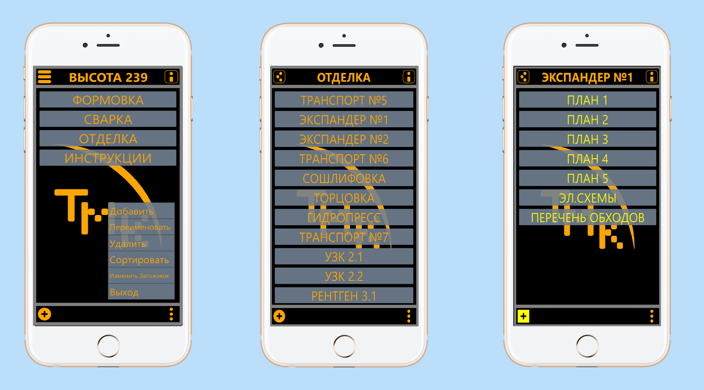

# Mentor (Ментор)

Desktop application: a catalog editor for working documents with a built-in viewer.
UI: QML, application code: C++, data storage: SQLite.
Interface languages: Russian and English. The language is detected from the system locale
on the first launch and can be changed at any time in the menu.

Application structure: Menu -> (Title + List) -> Elements -> (Data + Viewer) -> File Manager.

## Features

- Single storage: the catalog, documents and title data live in one SQL database (SQLite).
  Backup and transfer of the catalog is done by copying a single folder.
- Works offline, no internet connection required.
- Catalog search; full-text search inside PDF documents (Ctrl+F, F3 — next match).
- PDF viewer: open, paging, zooming (including pinch-to-zoom on tablets), rotation.
- Two work modes: ADMINISTRATOR (create and delete) and WORKER (view only).
  The mode flag (isAdmin) is set at project compile time.
- Hints in the Toolbar, hotkeys for standard operations, adjustable font size.

## Installation and build

### Ubuntu 22.04+

Requirements:
- Qt 6, components: Core, Quick, QuickControls2, Sql (SQLite driver), Pdf, PdfQuick;
- a C++17-capable compiler, CMake 3.14+, git.

1. Install Qt 6 and dependencies:

```bash
sudo apt update
sudo apt install -y build-essential cmake git \
  qt6-base-dev qt6-declarative-dev qml6-module-qtquick qtqml \
  qml6-module-qtquick-controls qml6-module-qtquick-templates \
  qml6-module-qtquick-window qml6-module-qtquick-dialogs \
  qt6-pdf-dev qml6-module-qtquick-pdf libqt6sql6-sqlite
```

2. Clone the repository:

```bash
git clone https://github.com/DruidCat/qt-working-diagrams.git
cd qt-working-diagrams
```

3. Build the project (qmake build is also supported, file `ru.Mentor.pro`):

```bash
cmake -S . -B build
cmake --build build -j$(nproc)
```

4. Run the application:

```bash
./build/ru.Mentor
```

### Windows 10, 11

Requirements:
- Qt 6 from the Qt Online Installer (https://www.qt.io/download).
  Components: Qt 6.x — Core, Quick, Quick Controls 2, SQL (SQLite driver), Qt PDF.
  A C++17 compiler (MSVC or MinGW from the Qt installer).
- CMake 3.14+ or Qt Creator (shipped with Qt).

Build:
1. Open the project in Qt Creator: `CMakeLists.txt` or `ru.Mentor.pro` -> Configure -> Build.
2. Run `ru.Mentor.exe` from the build folder.

### macOS 11 (Big Sur) and later

A prebuilt release is available in Releases: `ru.Mentor-<version>-macos.zip`
(universal: Intel and Apple Silicon). Unpack the archive and move `ru.Mentor.app`
to the Applications folder. On first launch open the app via right click -> Open:
the build is signed ad-hoc and is not registered with Apple.

Building from sources:

Requirements:
- Qt 6 from the Qt Online Installer (https://www.qt.io/download).
  Components: Qt 6.x — Core, Quick, Quick Controls 2, SQL (SQLite driver), Qt PDF.
- Xcode Command Line Tools (`xcode-select --install`), CMake 3.14+ or Qt Creator.
- macOS 11 and later are supported (the build is verified with Qt 6.7.3).

```bash
cmake -S . -B build
cmake --build build -j$(sysctl -n hw.ncpu)
open build/ru.Mentor.app
```

### Android

Build from Qt Creator using the Android kit.
The manifest and resources are in the [android](android) folder.
The minimum supported version is Android 6.0 (API 23).

#### Automated APK build on Ubuntu

On Ubuntu 22.04 or later the whole Android build can be delegated to
[tools/compilation_android_admin.sh](tools/compilation_android_admin.sh).
Run it from the repository root:

```bash
cd qt-working-diagrams
bash tools/compilation_android_admin.sh
```

The script then:

1. Checks the base utilities (git, cmake, ninja, python3, zip, unzip, curl,
   7za, JDK 11) and offers to install any that are missing (apt / Adoptium).
2. Checks Qt 6.7.3 in `~/Qt6/6.7.3` (host `gcc_64`, `android_armv7`,
   `android_arm64_v8a`); if absent it downloads it from the official
   ftp.fau.de mirror and installs it.
3. Checks the Android SDK in `~/Android/Sdk` (platform-34, build-tools 34.0.0,
   NDK 26.1.10909125) and downloads anything missing from dl.google.com.
4. Builds the app for **both processor families**, `armeabi-v7a` (32-bit) and
   `arm64-v8a` (64-bit), as two separate APKs: `...-arm64.apk` for modern
   64-bit phones and `...-armv7.apk` for older 32-bit ones.
5. Signs the APK with your own release key `~/secrets/mentor-release.keystore`
   (passphrase in `~/secrets/mentor-release-keystore-pass.txt`). Every builder
   creates and keeps their own key; if none is found the script prints how to
   create and place one. If you decline signing, a debug key is used - the app
   installs but cannot be updated over release versions.
6. Prints build statistics: size, version, minSdk/targetSdk, ABI list,
   signing certificate fingerprint and elapsed time.

The result is two files in the project root: `mentor-admin-<version>-arm64.apk`
and `mentor-admin-<version>-armv7.apk` (for example
`mentor-admin-1.1.1-14-arm64.apk`, where the number after the version is the
count of commits since the nearest tag). These are **"Administrator" user-mode
builds**:
the document database and PDFs are not embedded into the APK, the app works
with the shared device storage. The hardened build for field workers
(encrypted data, non-admin mode) is configured separately and is not produced
by this script.

The hardened build for field workers is produced by a separate script
[tools/compilation_android_worker.sh](tools/compilation_android_worker.sh).
It builds with `MENTOR_DB_MOBILE=ON` + `MENTOR_DATA_ENCRYPTED=ON`: worker
mode (no administrator) and workingdata encrypted inside the APK. Run it
from the repository root:

```bash
bash tools/compilation_android_worker.sh
```

On top of the usual dependencies it additionally requires (these cannot be
downloaded - copy them from the main build machine):

- `~/secrets/mentor-licensing/license.json` - the license: master secret and
  the list of allowed device codes. Always copy the very same file: a new
  master secret makes every previously issued APK unreadable.
- the workingdata directory (~553 MB) - via `MENTOR_WORKINGDATA` or
  `<repo>/workingdata`;
- the release key `~/secrets/mentor-release.keystore` (the same one the admin
  script uses).

The script then:

1. Checks the license and the data; if either is missing it stops and prints
   exactly what has to be copied.
2. Encrypts workingdata with `tools/shifruj_dannie.py`: the APK assets then
   contain the AES-256-GCM blob `dannie.tar.enc` plus `licenziya.bin` with
   one entry per allowed device code.
3. Builds both ABIs (arm64 and armv7 - separate APKs) and signs them.

The result is two files in the project root: `mentor-worker-<version>-arm64.apk`
and `mentor-worker-<version>-armv7.apk`. On first start the app unpacks the
documents once (about 30 seconds) if the phone's code is listed in the
license. A phone whose code is not listed installs and starts but shows no
documents; its code is shown on the "About" page.

## Usage

On start, the application opens the document catalog following the scheme
Menu -> List -> Elements -> Data -> Viewer.

- ADMINISTRATOR: creates Lists and Elements, attaches documents via the File Manager,
  keeps a journal, picks the viewer.
- WORKER: browses catalogs and documents only, no create or delete.
- F1 — side panel (bookmarks, instructions). Ctrl+F — search inside an open PDF, F3 — next match.
- Font size adapts to the screen; hotkeys are defined for standard operations.

On first run the application reads documents from the `workingdata` folder next to the
executable; the database and the documents are stored in one folder.

## Project structure

```
qt-working-diagrams/
├── qml/                    # QML source code and interface resources
│   ├── DCButtons/          # Application buttons (the DCButtons library)
│   ├── DCMethods/          # Application widgets and methods
│   ├── DCPages/            # Pages (Menu, List, Elements, Data, File Manager)
│   └── ru.Mentor.qml       # Main qml file — the application window
├── src/                    # C++ source code
│   └── main.cpp            # Application entry point
├── js/                     # JavaScript files (JSON helper functions)
├── i18n/                   # Interface translations: mentor_en.ts (catalog) and mentor_en.qm (compiled)
├── icons/                  # App icons for supported screen resolutions
├── fonts/                  # Application fonts
├── images/                 # Interface images
├── workingdata/            # Database and documents
├── android/                # Android manifest and resources
├── tools/                  # Helper scripts (icon regeneration, data synchronization)
├── CMakeLists.txt          # Project structure for the cmake build system
├── ru.Mentor.pro           # Project structure for the qmake build system
└── qml.qrc                 # Project resource table
```

## How the application is built

- [DCDB](src/dcdb.h) — class working with the SQL database.
- [DCDBData](src/dcdbdata.h) — class working with files stored inside the SQL database.
- [DCCppQml](src/cppqml.h) — the single driver binding the C++ and QML code together.
- [DCPdfPoisk](src/dcpdfpoisk.h) — full-text search across PDF documents.
- [DCLogger](src/dclogger.h) — application error journal.
- [Stranica](qml/DCPages/Stranica.qml) — the main UI template of the program.

## Compatibility

The project is compatible with:

* Windows 8, 10, 11.
* GNU/Linux.
* macOS 11 (Big Sur) and later.
* Android 6.0 (API 23) and later.
* Aurora OS 5.2.
* iOS.

## Tasks and bugs

All tasks, plans and bugs are tracked in
[GitHub Issues](https://github.com/DruidCat/qt-working-diagrams/issues).
Code fixes close a task with a `Closes #N` line in the commit message.

## Terms of use and participation

The project source code is provided under the [GPLv3 license](LICENSE.GPLv3.md), which requires
source code disclosure.

The [Contributor Agreement](CONTRIBUTING.md) governs the rights granted by contributors to the DruidCat
company.

Contributor information is in the [AUTHORS](AUTHORS.md) file.

The [Code of Conduct](CODE_OF_CONDUCT.md) is the current set of DruidCat company rules informing about the
expectations for interaction between community members when communicating and working on projects.

## Screenshots



## Author

DruidCat

## Links

- GitHub: https://github.com/DruidCat/qt-working-diagrams
- Qt6 documentation: https://doc.qt.io/qt-6/
- Qt Creator: https://www.qt.io/download

## Этот документ на русском

- [README.md](README.md)

## Support the project

If you found the project useful, you can support its development by a bank transfer via the QR
code below (SBP). This is entirely optional and in no way expected — but it genuinely helps.


