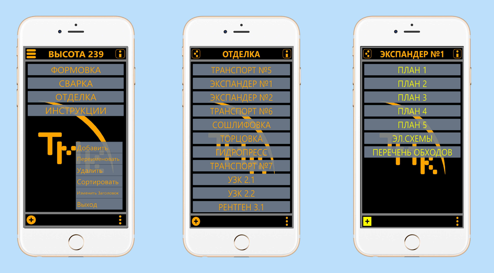

# Ментор (Mentor)

Настольное приложение — редактор каталогов рабочих документов со встроенным просмотрщиком.
Интерфейс: QML, код приложения: C++, хранение данных: SQLite.

Структура программы: Меню -> (Титул + Список) -> Элементы -> (Данные + Просмотрщик) -> Проводник.

## Возможности

- Единое хранилище: каталог, документы и титульные данные в одной SQL базе (SQLite).
  Резервная копия и перенос каталога — копированием одной папки.
- Работа без подключения к интернету.
- Поиск по каталогу; полнотекстовый поиск внутри PDF-документов (Ctrl+F, F3 — следующее совпадение).
- Просмотр PDF: открытие, листание, масштабирование (в том числе щипком на планшете), поворот.
- Два режима работы: АДМИНИСТРАТОР (создание и удаление) и РАБОТНИК (только просмотр).
  Флаг режима (isAdmin) задаётся при компиляции проекта.
- Подсказки в Toolbar, горячие клавиши для стандартных операций, регулировка размера шрифта.

## Установка и сборка

### Ubuntu 22.04+

Требования:
- Qt 6, компоненты: Core, Quick, QuickControls2, Sql (драйвер SQLite), Pdf, PdfQuick;
- компилятор с поддержкой C++17, CMake 3.14+, git.

1. Установить Qt 6 и зависимости:

```bash
sudo apt update
sudo apt install -y build-essential cmake git \
  qt6-base-dev qt6-declarative-dev qml6-module-qtquick qtqml \
  qml6-module-qtquick-controls qml6-module-qtquick-templates \
  qml6-module-qtquick-window qml6-module-qtquick-dialogs \
  qt6-pdf-dev qml6-module-qtquick-pdf libqt6sql6-sqlite
```

2. Клонировать репозиторий:

```bash
git clone https://github.com/DruidCat/qt-working-diagrams.git
cd qt-working-diagrams
```

3. Собрать проект (допустима также сборка через qmake, файл `ru.Mentor.pro`):

```bash
cmake -S . -B build
cmake --build build -j$(nproc)
```

4. Запустить приложение:

```bash
./build/ru.Mentor
```

### Windows 10, 11

Требования:
- Qt 6 из Qt Online Installer (https://www.qt.io/download).
  Компоненты: Qt 6.x — Core, Quick, Quick Controls 2, SQL (драйвер SQLite), Qt PDF.
  Компилятор C++17 (MSVC или MinGW из установщика Qt).
- CMake 3.14+ или Qt Creator (поставляется с Qt).

Сборка:
1. Открыть проект в Qt Creator: `CMakeLists.txt` или `ru.Mentor.pro` -> Configure -> Build.
2. Запустить `ru.Mentor.exe` из каталога сборки.

### AltLinux

Требования: пакеты Qt 6 из репозитория AltLinux, список — в файле
[Qt6_AltLinux.txt](Qt6_AltLinux.txt). Заметки по Qt 5.15 — в [Qt5_AltLinux.txt](Qt5_AltLinux.txt).

Сборка: те же команды CMake, что в разделе Ubuntu.

### Android

Сборка из Qt Creator с использованием Android-комплекта.
Манифест и ресурсы находятся в каталоге [android](android).

## Использование

После запуска приложение открывает каталог документов по схеме
Меню -> Список -> Элементы -> Данные -> Просмотрщик.

- АДМИНИСТРАТОР: создаёт Списки и Элементы, добавляет документы через Проводник,
  ведёт журнал, выбирает просмотрщик.
- РАБОТНИК: только просмотр каталогов и документов, без создания и удаления.
- F1 — боковая панель (закладки, инструкция). Ctrl+F — поиск по открытому PDF, F3 — далее.
- Размер шрифта подстраивается под экран; горячие клавиши заданы для стандартных операций.

При первом запуске приложение читает документы из каталога `workingdata` рядом
с исполняемым файлом; база данных и документы хранятся в одном каталоге.

## Структура проекта

```
qt-working-diagrams/
├── qml/                    # Исходный код на QML и ресурсы интерфейса
│   ├── DCButtons/          # Кнопки приложения (библиотека DCButtons)
│   ├── DCMethods/          # Виджеты и методы приложения
│   ├── DCPages/            # Страницы (Меню, Список, Элементы, Данные, Проводник)
│   └── ru.Mentor.qml       # Главный qml файл — окно приложения
├── src/                    # Исходный код на C++
│   └── main.cpp            # Точка входа в приложение
├── js/                     # Java Script файлы (функции для работы с JSON)
├── icons/                  # Иконки приложения для поддерживаемых разрешений экрана
├── fonts/                  # Шрифты приложения
├── images/                 # Изображения интерфейса
├── workingdata/            # База данных и документы
├── android/                # Манифест и ресурсы для сборки под Android
├── CMakeLists.txt          # Структура проекта для системы сборки cmake
├── ru.Mentor.pro           # Структура проекта для системы сборки qmake
└── qml.qrc                 # Таблица ресурсов проекта
```

## Как устроено приложение

- [DCDB](src/dcdb.h) — класс, работающий с SQL базой данных.
- [DCDBData](src/dcdbdata.h) — класс, работающий с файлами, записанными в SQL базу данных.
- [DCCppQml](src/cppqml.h) — единственный драйвер, связывающий C++ и QML код друг с другом.
- [DCPdfPoisk](src/dcpdfpoisk.h) — поиск текста по PDF документам.
- [DCLogger](src/dclogger.h) — журнал ошибок приложения.
- [Stranica](qml/DCPages/Stranica.qml) — основной шаблон интерфейса программы.

## Совместимость

Проект совместим с:

* Windows 7, 8, 10, 11.
* GNU/Linux.
* MacOS.
* Android.
* iOS.

## Задачи и баги

Все задачи, планы и баги ведутся в [GitHub Issues](https://github.com/DruidCat/qt-working-diagrams/issues).
Исправления в коде закрывают задачу строкой `Closes #N` в сообщении коммита.

## Условия использования и участия

Исходный код проекта предоставляется по [лицензии GPLv3](LICENSE.GPLv3.md), которая обязывает раскрытие
исходного кода.

[Соглашение участника](CONTRIBUTING.md) регламентирует права, предоставляемые участниками компании «DruidCat».

Информация об участниках указана в файле [AUTHORS](AUTHORS.md).

[Кодекс поведения](CODE_OF_CONDUCT.md) — действующий набор правил компании «DruidCat», который информирует об
ожиданиях по взаимодействию между членами сообщества при общении и работе над проектами.

## Снимки экранов



## Автор

DruidCat

## Ссылки

- GitHub: https://github.com/DruidCat/qt-working-diagrams
- Документация Qt6: https://doc.qt.io/qt-6/
- Qt Creator: https://www.qt.io/download

## This document in English

- [README.en.md](README.en.md)
