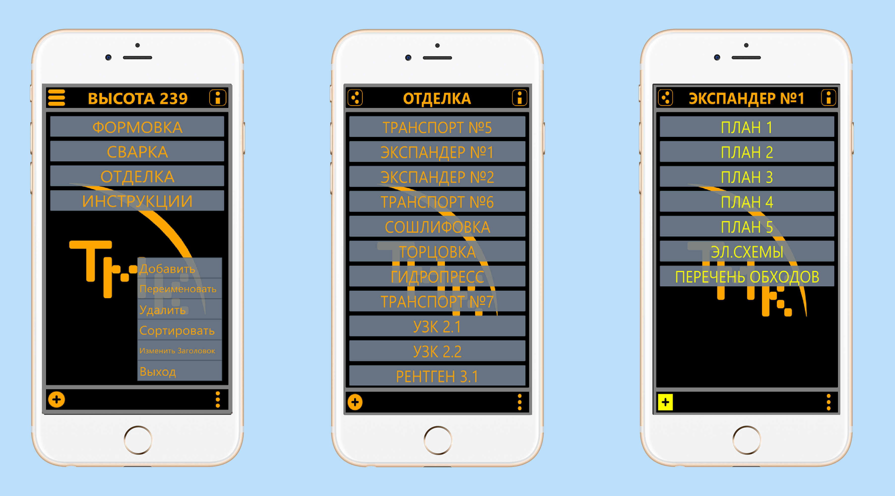

# Ментор (Mentor)

Держи все рабочие документы в одном месте. Найди нужную схему или инструкцию за секунды, а не за часы
поисков по папкам!

## Описание

Ментор — это desktop-приложение с графическим интерфейсом: редактор каталогов документов и их просмотрщик.
Главная цель — создать каталог документов, необходимых для работы здесь и сейчас. Все документы хранятся
в единой SQL базе данных, поэтому каталог можно перенести на любой компьютер или телефон целиком.

Структура программы: Меню -> (Титул + Список) -> Элементы -> (Данные + Просмотрщик) -> Проводник.

## Чем полезен Ментор

- **Порядок вместо хаоса.** Документы раскладываются по полочкам:
  Список -> Элементы -> Данные.
- **Быстрый поиск.** Поиск по каталогу и поиск текста прямо внутри PDF (Ctrl+F, F3 — далее).
- **Работает офлайн.** Все документы в локальной SQLite базе — интернет не нужен, данные всегда при тебе.
- **Два режима работы.** АДМИНИСТРАТОР создаёт и удаляет каталоги документов; РАБОТНИК только просматривает —
  просто объяснить новичку, что можно, а чего нельзя.
- **Понятно с первого запуска.** Подсказки в Toolbar на каждом шаге, горячие клавиши на стандартные операции,
  регулировка размера шрифта под любой экран — хоть монитор, хоть телефон.
- **Просмотрщик PDF «из коробки».** Открытие, листание, поворот, масштабирование
  (в том числе щипком на планшете).
- **Единая база на всё.** Каталог, документы и титульные данные живут в одной базе —
  копия и перенос в один шаг.

## Требования

- Qt 6 (компоненты: Core, Quick, QuickControls2, Sql, Pdf, PdfQuick)
- Компилятор с поддержкой C++17
- CMake 3.14+ или Qt Creator (сборка через qmake)
- SQLite (входит в состав Qt)

## Установка и сборка

### Ubuntu 22.04+

1. **Установите Qt6 и зависимости:**

```bash
sudo apt update
sudo apt install -y build-essential cmake git \
  qt6-base-dev qt6-declarative-dev qml6-module-qtquick qtqml \
  qml6-module-qtquick-controls qml6-module-qtquick-templates \
  qml6-module-qtquick-window qml6-module-qtquick-dialogs \
  qt6-pdf-dev qml6-module-qtquick-pdf libqt6sql6-sqlite
```

2. **Клонируйте репозиторий:**

```bash
git clone https://github.com/DruidCat/qt-working-diagrams.git
cd qt-working-diagrams
```

3. **Соберите проект:**

```bash
cmake -S . -B build
cmake --build build -j$(nproc)
```

4. **Запустите приложение:**

```bash
./build/ru.Mentor
```

### Windows 10, 11

1. Установите Qt6 с официального сайта: https://www.qt.io/download (Qt Online Installer).
   При выборе компонентов отметьте Qt 6.x, Quick Controls 2, QML, SQL (SQLite driver) и Qt PDF.
2. Откройте проект в Qt Creator: файл `CMakeLists.txt` или `ru.Mentor.pro` -> Configure -> Build.
3. Запустите собранное приложение `ru.Mentor.exe` из папки сборки.

### AltLinux

Список пакетов Qt6 для сборки из репозитория AltLinux — в файле [Qt6_AltLinux.txt](Qt6_AltLinux.txt),
заметки по Qt5.15 — в [Qt5_AltLinux.txt](Qt5_AltLinux.txt).

### Android

Проект собирается под Android из Qt Creator (каталог [android](android) содержит манифест и ресурсы).

## Использование

После запуска приложение открывает каталог документов по схеме Меню -> Список -> Элементы -> Данные ->
Просмотрщик.

- **АДМИНИСТРАТОР** создаёт Списки и Элементы, подключает документы через Проводник, ведёт журнал,
  выбирает просмотрщик. Флаг режима (isAdmin) задаётся при компиляции проекта.
- **РАБОТНИК** только просматривает каталоги и документы — без создания и удаления.
- Боковая панель (закладки, инструкция) — клавиша F1. Поиск по открытому PDF — Ctrl+F, далее — F3.
- Размер шрифта подстраивается под экран; горячие клавиши есть для всех стандартных операций.

Первые документы приложение читает из каталога `workingdata` рядом с исполняемым файлом — база и документы
хранятся в одном каталоге.

## Структура проекта

```
qt-working-diagrams/
├── qml/                    # Исходный код на QML и ресурсы интерфейса
│   ├── DCButtons/          # Кнопки приложения (библиотека DCButtons)
│   ├── DCMethods/          # Виджеты и методы приложения
│   ├── DCPages/            # Страницы (Меню, Список, Элементы, Данные, Проводник)
│   └── ru.Mentor.qml       # Главный qml файл — окно приложения
├── src/                    # Исходный код на C++
│   └── main.cpp            # Точка входа в приложение
├── js/                     # Java Script файлы (функции для работы с JSON)
├── icons/                  # Иконки приложения для поддерживаемых разрешений экрана
├── fonts/                  # Шрифты приложения
├── images/                 # Изображения интерфейса
├── workingdata/            # База данных и документы
├── android/                # Манифест и ресурсы для сборки под Android
├── CMakeLists.txt          # Структура проекта для системы сборки cmake
├── ru.Mentor.pro           # Структура проекта для системы сборки qmake
└── qml.qrc                 # Таблица ресурсов проекта
```

## Как устроено приложение

- [DCDB](src/dcdb.h) — класс, работающий с SQL базой данных.
- [DCDBData](src/dcdbdata.h) — класс, работающий с файлами, записанными в SQL базу данных.
- [DCCppQml](src/cppqml.h) — единственный драйвер, связывающий C++ и QML код друг с другом.
- [DCPdfPoisk](src/dcpdfpoisk.h) — поиск текста по PDF документам.
- [DCLogger](src/dclogger.h) — журнал ошибок приложения.
- [Stranica](qml/DCPages/Stranica.qml) — основной шаблон интерфейса программы.

## Совместимость

Проект совместим с:

* Windows 7, 8, 10, 11.
* GNU/Linux.
* MacOS.
* Android.
* iOS.

## Задачи и баги

Все задачи, планы и баги ведутся в [GitHub Issues](https://github.com/DruidCat/qt-working-diagrams/issues).
Нашли баг или хотите предложить функцию? Создайте issue! Исправления в коде закрывают задачу комментарием
`Closes #N` в сообщении коммита.

## Условия использования и участия

Исходный код проекта предоставляется по [лицензии GPLv3](LICENSE.GPLv3.md), которая обязывает раскрытие
исходного кода.

[Соглашение участника](CONTRIBUTING.md) регламентирует права, предоставляемые участниками компании «DruidCat».

Информация об участниках указана в файле [AUTHORS](AUTHORS.md).

[Кодекс поведения](CODE_OF_CONDUCT.md) — действующий набор правил компании «DruidCat», который информирует об
ожиданиях по взаимодействию между членами сообщества при общении и работе над проектами.

## Снимки экранов



## Автор

DruidCat

## Ссылки

- GitHub: https://github.com/DruidCat/qt-working-diagrams
- Документация Qt6: https://doc.qt.io/qt-6/
- Qt Creator: https://www.qt.io/download

## This document in English

- [README.md](README.md)
